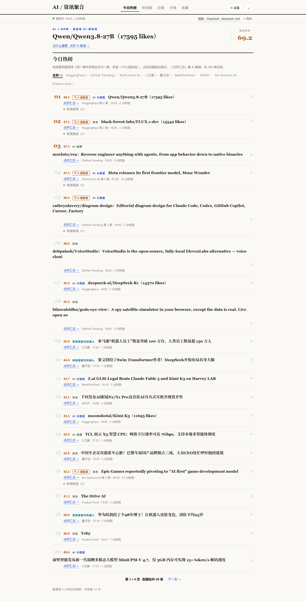
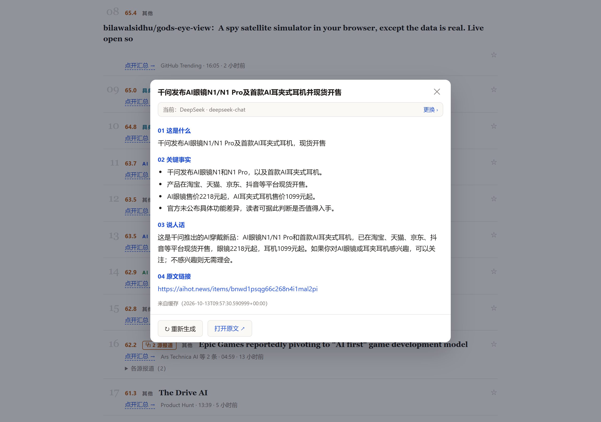
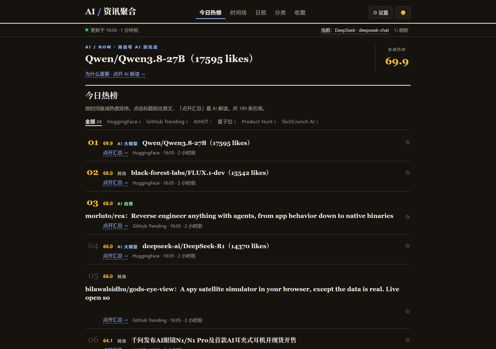
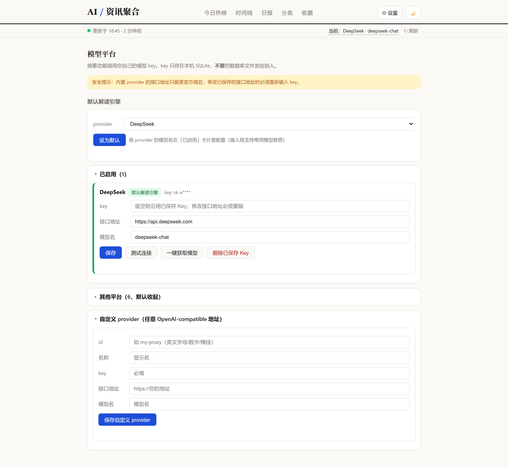

# AI 资讯聚合（开源版 · v0.4）

**中文** | [English](README_EN.md)

一个自托管的 AI 资讯聚合站：定时抓取 19 个 AI 信息源，按"时间衰减热度"排出今日热榜（同一事件多源自动合并、支持按你的兴趣个性化）；另有时间线、日报、主题视图；点击新闻弹出 AI 摘要（用你自己的模型 key）；收藏自带正文存档；不感兴趣一键屏蔽；UI 自定义加 RSS 源。单文件 SQLite，数据全在自己机器上。

## 效果图

| 热榜（故事合并 + 刊物风） | 摘要弹窗（四段式） |
|---|---|
|  |  |

| 深色模式 | 模型平台（右侧抽屉） |
|---|---|
|  |  |

## 功能一览

- **热榜**：时间衰减热度（48h 半衰）+ 每源配额（最多 4 席，防单源霸榜）+ **故事合并**（同一事件多源归一席，中英文跨语言匹配，多源报道热度加成）+ 分页
- **为我精选（自我进化）**：自动记录你的行为（点摘要/收藏/屏蔽）→ 一键 AI 蒸馏兴趣画像 → 喜欢的主题上浮、不感兴趣的消失；画像本地存储、可编辑可重置
- **AI 摘要**：四段式中文解读（这是什么/关键事实/说人话/原文链接），按 URL 缓存；正文抓取失败自动回退 RSS 摘要
- **19 个信息源**：10 个基础源 + 9 个从 AIHOT 拆出的直接上游（OpenAI/DeepMind/Hacker News/Ars Technica 等官方一手源）；**设置页可零代码添加任意 RSS 源**
- **收藏即存档**：收藏时抓正文快照，原文失效仍可读
- **不感兴趣**：条目 ✕ 一键屏蔽（URL/来源/分类三层），热榜时间线即刻生效
- **体验细节**：已读蓝点/只看未读/新内容横幅、来源筛选、GitHub 项目一键 Clone/Fork/部署、源健康面板（哪个源失败一眼可见）、深色模式、移动端适配

## 快速启动（三种安装方式）

### 方式一：下载可执行文件（无需 Python，推荐新手）

到 [Releases](../../releases) 下载对应平台的单文件可执行（`ai-news.exe` / `ai-news`），放到任意目录**双击运行**——自动创建数据库、自动抓取、自动打开浏览器。数据保存在同目录 `data/` 下。

### 方式二：pip 安装（有 Python 环境）

```bash
pipx install git+https://github.com/aspiring0/ai-news-digest.git   # 或 pip install 后确保脚本目录在 PATH
ai-news            # 启动并自动打开浏览器
```

### 方式三：源码脚本（开发者）

```bash
# 1. 拿到代码后进入目录（可选）复制配置
cp .env.example .env   # 不改也行，直接用默认配置

# 2. 启动
./start.sh             # Linux / macOS（先 chmod +x start.sh）
# start.bat            # Windows：双击即可

# 3. 打开浏览器
# http://localhost:8000/hot        今日热榜
# http://localhost:8000/timeline   时间线
# http://localhost:8000/daily      日报（今日 top 20 按主题分组）
# http://localhost:8000/topics     主题分类
# http://localhost:8000/bookmarks  收藏
# http://localhost:8000/settings   模型设置（配 key）
```

三种方式功能完全一致；首次启动自动抓取一轮（约 1 分钟），之后每 4 小时一次。数据库都是单文件 `data/news.db`（备份拷走就行）。

> 源码方式细节（开机自启 / 常见问题）→ 看 **[DEPLOY.md](DEPLOY.md)**。
>
> **安全提示**：服务默认只监听 `127.0.0.1`（本机访问）。局域网共享请把 `.env` 的 `HOST` 改为 `0.0.0.0`；**不要直接暴露公网**（无内置鉴权，模型 key 存本机），公网访问请自行加反向代理 + 访问控制。AI 摘要只抓取站内条目的正文，且服务端抓取默认拒绝内网/保留网段地址（防 SSRF；内网 RSS 源用户见 `ALLOW_PRIVATE_FETCH`）。

## 信息源（v0.1）

| 来源 | 抓取方式 | 状态 |
|---|---|---|
| AIHOT（精选） | RSS（`aihot.news/feed.xml`） | ✅ 2026-10-13 实测可用。注意旧域名 `aihot.virxact.com` 2026-10-31 起停用，已换新域名 |
| TLDR AI | 官方 RSS | ✅（只含标题+链接，无摘要） |
| Superhuman | 社区生成 RSS（GitHub Action 每日更新） | ✅ |
| The Rundown | 官方 RSS（beehiiv `/feed`） | ✅ |
| 量子位 | 官方 RSS | ✅ |
| TechCrunch AI | 官方 RSS | ✅ |
| The Batch | 社区生成 RSS | ✅ |
| HuggingFace 热门模型 | 公开 API（`huggingface.co/api/models`，无需 key） | ✅ |
| Product Hunt | 公开 Atom feed（无票数） | ✅ |
| GitHub Trending | 公开 HTML 解析 | ✅（页面结构若变，解析失败会自动跳过并记日志） |
| 机器之心 | RSS 已下线（`/rss` 跳转到推广页） | ⏭️ 本版跳过 |
| 智东西 | 无公开 RSS | ⏭️ 本版跳过 |

### v0.3.3 新增：直接订阅上游源（原经 AIHOT 中转）

| 来源 | 抓取方式 | 状态 |
|---|---|---|
| Ars Technica AI | 官方 RSS（`arstechnica.com/ai/feed`） | ✅ 2026-10-13 实测可用 |
| Hacker News AI | hnrss 官方过滤（AI 关键词 + >100 赞） | ✅ |
| OpenAI | 官方 News RSS（取最新 10 条） | ✅ |
| Google DeepMind | 官方博客 RSS | ✅ |
| IT之家 | 全站 RSS + AI 关键词过滤（AI 分类 feed 已 404） | ✅ |
| VentureBeat AI | 官方分类 RSS | ✅ |
| The Decoder | RSS 被反爬挡（返回 HTML） | ⏭️ 未收录，其内容经 AIHOT 兜底 |

### v0.3.4 新增：再拆 3 个稳定上游（全部免 key）

| 来源 | 抓取方式 | 状态 |
|---|---|---|
| MarkTechPost | 官方 RSS | ✅ 2026-10-13 实测可用 |
| Tessl（产品与工程博客） | 官方 RSS | ✅ |
| GitHub Releases | GitHub 官方 Atom（openai/codex、anthropics/claude-code，无需 key） | ✅ |
| Sierra / ARC Prize / Comfy Blog | 探测成功一轮后即被源站限流（404/全 UA） | ⏭️ 稳定性不足未收录，如需可自行加回 `app/fetchers/` |
| Vapi / Meshy / Artificial Analysis / Amazon Science / Anthropic / xAI / LangChain / Redwood / Epoch / Prime Intellect | 无公开 RSS | ⏭️ 跳过，经 AIHOT 兜底 |
| X/Twitter 个人号、微信公众号、YouTube、播客 | 平台无 RSS（需平台 API key） | ⏭️ 按约定跳过 |

### 拆上游续批：+10 个一手源（聚合器保留并行，2026-10-15 探测）

平台 RSS 直连（Google Research / Microsoft Research / Azure AI / Mistral / NVIDIA / MIT News AI，`lab` 打分类 68 起）+ 无 RSS 厂商 HTML 抓取（Anthropic / Meta AI / xAI / Cohere，走 `parse_link_page` 通用管线）。

| 来源 | 抓取方式 | 状态 |
|---|---|---|
| Google Research / Microsoft Research / Azure AI / Mistral / NVIDIA / MIT News AI | 官方 RSS（limit 15-25） | ✅ 2026-10-15 探测可用 |
| Anthropic | 官网新闻页 HTML（无 RSS） | ⚠️ 可抓但两次探测结构不一致，观察期重点 |
| Meta AI | 官网博客 HTML（标题在 aria-label，链接带尾斜杠） | ✅ |
| xAI | 官网新闻页 HTML（标题含描述粘连，截断展示） | ✅ |
| Cohere | 官网博客 HTML（页面 ~1MB，limit 12） | ✅ |
| arXiv（cs.AI/CL/LG） | 官方 RSS，`paper` 低分入榜（55 起），每分类限 15 条，翻译配额排除 | ✅ 2026-10-15 RSS 恢复后接入；曾整日空快照，连续两轮 0 条需人工复查 |
| HuggingFace Daily Papers | 连接重置（与 HF 源同网络问题） | ⏭️ **后期补**：网络恢复后探测 |
| Stanford HAI / Google blog 主站 | 前者锚点无文章条目；后者与 Google Research 重叠 | ⏭️ 暂缓 |

单个源失败只记日志，不影响其他源；收录源跑两轮后看设置页「源健康」面板，不稳的随时一行摘除（上批 Sierra 教训）。

## 热榜是怎么排的

1. **静态分**：抓取时按源内位置一次写入——RSS 类 66 起每位 -2（不低于 48）；实验室/厂商一手（`lab`）类 68 起每位 -2（不低于 50）；HuggingFace 类 72 起每位 -2（不低于 50）；ProductHunt/GitHub 类 70 起每位 -2（不低于 54）；AIHOT 采用上游分（无则按 RSS 规则 66 起步）。
2. **热榜分（实时计算，原始分不动）**：`hot_score = score × 0.5^(age_hours / 48)`，年龄按发布时间算（缺失则按入库时间）。48 小时半衰：两天前的条目热度减半，新内容自然上浮，旧"钉子户"自然下沉。
3. **多样性配额（v0.3.2）**：热榜 top20 **每个来源最多占 4 席**——高分源（HuggingFace/GitHub 等）不再霸榜，新闻源（AIHOT/量子位等）稳定可见；只影响热榜展示，不改动数据。
4. **故事合并（v0.3.5）**：热榜按"故事"聚合——标题共享 **≥2 个实体**且 **48 小时内**的条目视为同一事件，只占一席，显示「⧉ N 源报道」徽标（可展开看各源标题）；**故事热度 = 成员最高分 ×（1 + 15%/额外来源）**，多源交叉验证的事件自然上浮。跨语言匹配靠产品/公司名的拉丁词（"Meta 发布 Muse Wonder" ↔ "Meta releases Muse Wonder"）；纯中文实体（如"固态电池"）暂不参与合并。

## 如何加一个新源

**方式一（零代码）**：网页 ⚙ 设置 → 「自定义 RSS 源」，填名称和 RSS 地址即可，下一轮抓取生效。

**方式二（写代码，适合无 RSS 的站）**：
1. 在 `app/fetchers/` 新建一个模块（参考 `qbitai.py`，RSS 源一般 10 行就够）：
   - 定义 `SOURCE_NAME`（显示名）、`SCORE_CLASS`（`rss` / `lab` / `hf` / `ph` / `search` / `aihot`）
   - 实现 `fetch() -> list[NewsItem]`（`title` / `url` / `source_name` / `published_at`）
2. 在 `app/fetchers/__init__.py` 的 `FETCHERS` 列表里加一行。
3. 重启服务即可。HTML 解析类源建议参考 `github_trending.py` 的写法：解析失败只记日志、不抛异常。

## 抓取频率说明

默认 **4 小时**一轮（`FETCH_INTERVAL_HOURS`，`.env` 可改）。**不要调太激进**：这些是别人的公开服务，1 小时以内一轮容易被限流甚至封 IP；4 小时对资讯聚合完全够用。社区生成的 RSS 源本身每天才更新一次，调快也没有意义。

数据只保留 14 天（每次抓取后自动清理），库不会无限膨胀。

## 配置

| 变量 | 默认值 | 说明 |
|---|---|---|
| `PORT` | `8000` | Web 端口 |
| `HOST` | `127.0.0.1` | 监听地址。局域网共享改 `0.0.0.0`；**公网部署请自行加反代与鉴权** |
| `ALLOW_PRIVATE_FETCH` | `0` | 服务端抓取（摘要正文/自定义源）默认拒绝内网与保留网段地址（防 SSRF）。内网 RSS 源场景才改 `1`；pip/exe 安装请设系统环境变量 |
| `TZ` | `Asia/Shanghai` | 时区（日报按此时区的自然天划分） |
| `FETCH_INTERVAL_HOURS` | `4` | 抓取间隔（小时） |
| `DATA_DIR` | `./data` | 数据目录，`news.db` 放在里面 |
| `DB_PATH` | （空） | 高级项：直接指定数据库文件路径，设置后优先于 `DATA_DIR` |

## AI 摘要

点击热榜/时间线/日报/主题/收藏里任意新闻标题，弹出摘要窗口：

1. **抓正文**：trafilatura → readability 依次尝试提取网页正文，都失败则用 **RSS 摘要兜底**（v0.3.6：RSS description 入库，付费墙/反爬文章也能出摘要）；正文截断约 6000 字符。
2. **调模型**：用你在设置页配置的默认解读引擎，走 OpenAI-compatible 的 `/chat/completions` 接口。
3. **四段式中文输出**：①一句话核心 ②说人话（这是什么、跟我有啥关系、要不要管）③关键细节 ④原文链接。

摘要按 URL 缓存进 SQLite（`summary_cache` 表），第二次打开直接读缓存、不再调模型；窗口里有"重新生成"按钮可强制刷新。

**key 成本提示**：
- 摘要是全站唯一的模型消费点。缓存按 URL 永久有效（除非点重新生成），所以正常浏览几乎不花钱。
- 别反复点"重新生成"——每次都是一次完整调用。GLM/DeepSeek 的 flash 级模型每篇约几分钱，GPT-4o 级约一两毛。
- 正文抓取失败（付费墙/反爬）时弹窗显示"摘要暂不可用"，不扣费、不影响列表。

## 设置页

`⚙️ 设置` 页管理模型 provider：

- **内置 6 家**：DeepSeek / 智谱 GLM / 通义 Qwen / Kimi / OpenAI / Gemini，每家填 key + 模型名即可，接口地址默认官方域名（Gemini 走其官方 OpenAI 兼容端点 `/v1beta/openai/`）。Anthropic 官方无 OpenAI 兼容端点，不内置，请用「自定义」填中转地址。
- **自定义**：任意 OpenAI-compatible 地址（如自建中转），id 以 `custom-` 开头。
- **一键测试连接**：保存前先点"测试连接"，确认 key 和模型名没填错。
- **默认解读引擎**：设为默认的 provider 负责生成摘要。

**安全规则**（防 key 被偷偷发到别人的服务器）：
1. 内置 provider 的接口地址只能是官方域名（白名单硬校验），想填别的域名请用"自定义"。
2. 修改已保存 provider 的接口地址时，必须重新输入 key（后端强制）。
3. key 只存在本机 SQLite（`provider_settings` 表），**不要**把 `data/news.db` 发给别人；`.env` 也不要提交到 git。

## License

MIT（见 [LICENSE](LICENSE)）。发布前请把 `LICENSE` 里的 `YOUR_NAME` 换成你的名字/网名。
